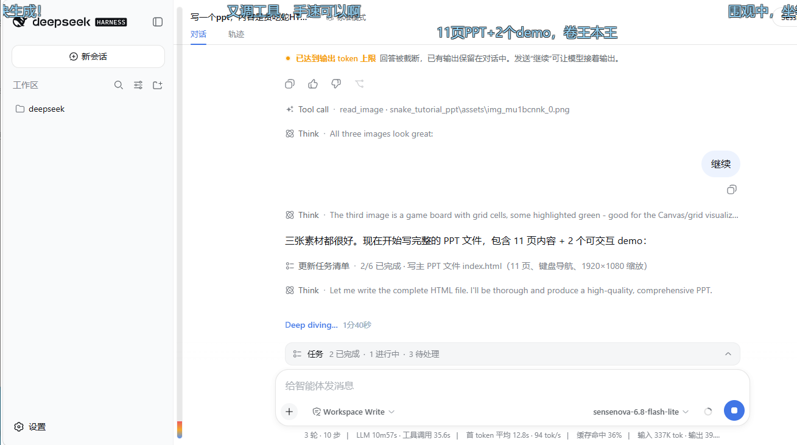
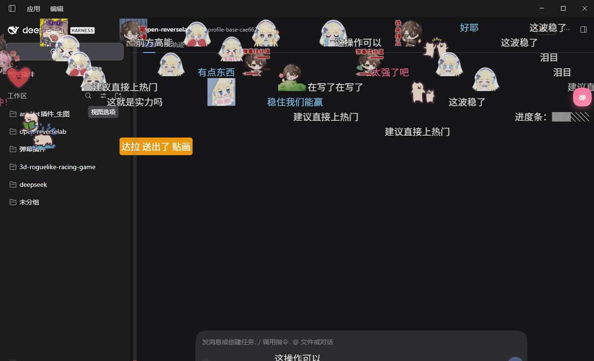

<div align="center">


# dsh-livechat

[](https://github.com/huashenglian/dsh-livechat)
[](#许可证)
[](https://github.com/deepseek-ai)

**给 [DeepSeek Harness](https://github.com/deepseek-ai)（`dsh`）Web 对话区叠加 B 站风格弹幕的插件。**

围观 agent 工作：用户消息、回复完成、工具调用、任务完成时，预设弹幕（可选 LLM 生成）横向飘过对话区——就像看直播一样。

`中文` · [English](./README.en.md)

[安装](#安装) · [功能](#功能) · [模块文档](#模块文档) · [架构](#架构)

</div>

---

## 安装

插件是 **bundle**：自带 `cordis.patch.yml`，自我激活——一条命令，无需手动改 patch。

```bash
# 本地目录安装
dsh plugin --profile web add ./dsh-livechat

# npm 安装（预构建，免 allowBuilds 构建授权）
dsh plugin --profile web add dsh-livechat

# GitHub 安装
dsh plugin --profile web add github:huashenglian/dsh-livechat

# tarball 安装（pnpm pack / npm pack 打包后）
dsh plugin --profile web add ./dsh-livechat-0.2.0.tgz
```

重启 `dsh web` 后打开 <http://127.0.0.1:3080>。弹幕覆盖层与浮动控制球会出现在对话区上方。

> [!NOTE]
> bundle 自带 `cordis.patch.yml` 自我激活（`insert id: livechat`）。**不要**在 profile 的 patch 里重复 insert——二次 insert 启动时会报 `duplicate loader entry id: livechat`。

若还没有 `dsh` CLI，可直接启动 web 服务：

```bash
npx @deepseek-ai/dsh web
```

### 快速健康检查

```bash
curl http://127.0.0.1:3080/api/danmaku/health
# {"ok":true,"name":"dsh-danmaku","version":"0.6.14"}
```

---

## 它做什么

当 agent 发送消息、回复完成、调用工具或完成任务时，一串弹幕飘过对话列——就像看直播。预设包覆盖通用 / 编程 / 闲聊氛围，可选 LLM 按节流生成即时、贴合上下文的吐槽。拖球提供快捷控制；设置卡可调一切。



*agent 工作时弹幕飘过对话区——多轨道、加权配色、右上浮动控制球。*

---

## 功能

| 模块 | 覆盖内容 | 文档 |
|---|---|---|
| **覆盖层与渲染** | `shell.overlay` 挂载、DOM 渲染器、多轨道防碰撞、防遮挡渐隐、渲染后端链 | [overlay-and-rendering.zh-CN.md](docs/overlay-and-rendering.zh-CN.md) |
| **预设包与 LLM** | 三套预设包、事件触发抽样、疲劳去重、预设功能总开关（关闭后仅剩 LLM）、可选 LLM 生成（smart/interval/toolcall 唤醒）、风格模板 | [presets-and-llm.zh-CN.md](docs/presets-and-llm.zh-CN.md) |
| **交互** | 拖球、悬停暂停、点击详情（复制/屏蔽/删除）、手发弹幕、热度条、欢迎与任务完成效果 | [interaction.zh-CN.md](docs/interaction.zh-CN.md) |
| **分会话弹幕库** | 分会话 `.jsonl` 弹幕池、历史回放（衰减+点赞加权）、归档/恢复、应用内池编辑器 | [session-pools.zh-CN.md](docs/session-pools.zh-CN.md) |
| **礼物特效** | 三栏大模态（左礼物库 / 中素材库 / 右配置，分界线可拖动且尺寸长期记忆）、左列搜索 + 单分类下拉（bilibili / 自定义，父子同浮窗）、中栏工具条（房间号提取 + 导入▾ + 图标大小 + 新建文件夹 + 清空素材）、素材即加即用（无需绑定）、素材卡点击显示特效位置（点网格空白取消选中）、右栏基础含全局/当前素材动画大小、「+」/红色「×」、默认 3 张礼物卡（总开关默认关、隐私零房间号） | [gift-effects.zh-CN.md](docs/gift-effects.zh-CN.md) |
| **配置与 API** | 设置卡 UI、全部配置字段（默认值+范围）、完整 HTTP API 参考 | [configuration.zh-CN.md](docs/configuration.zh-CN.md) |

### 亮点

- **三种布局**：滚动、顶部固定、底部固定——按权重生成
- **防遮挡**：阅读时覆盖层变暗，热闹时亮起
- **LLM 安全降级**：生成失败→静默降级预设，无报错弹窗（预设总开关关闭时不再降级，只剩 LLM）
- **AI 专属分会话记忆**：只有 LLM 弹幕会入池/回放/可点赞；预设保持现场生成；删除会话自动清理池
- **Chromium 优先**：为 Edge / Chrome 调优；`translate3d`、页面 `hidden` 暂停、同屏上限
- **暂停不消失**：悬停/详情锁定的弹幕会一直留在画面，直到恢复滚动并离开范围
- **关弹幕即关插件**：关掉「启用弹幕」后任何弹幕、礼物特效、礼物提示都不再触发，正在播放的礼物动画立即删除；礼物特效另有自己的 `giftEnabled` 闸门
- **配置不再重置**：每次保存同时写本地镜像（`$DSH_HOME/danmaku-config.json`）与 `settings.yaml` 里的精简 `danmaku:` 段；启动按「镜像 → settings → 默认」解析，重启不会丢配置
- **会话显名称**：弹幕库编辑器用 dsh 的真实会话名标注每个弹幕池，不再是截断的 sessionId

---

## 最近迭代更新

> 完整版本历史见 [`docs/version-history.md`](https://github.com/huashenglian/dsh-livechat)。以下是 0.6.x 的主要迭代：

| 版本 | 主要变化 |
|---|---|
| 0.6.14 | **隐私 + Emoji 渲染修复**（**本地已改，未发布**）：① **LLM 弹幕生成模型不再读取用户隐私信息**——会话文本、思考片段、工具名、警告与统计在**进入缓冲区时**先经 `redactSecrets()` 脱敏（`sk-`/`rk-`、GitHub/Slack/AWS/Google 密钥、JWT、`Bearer`、`apiKey=…`/`token: …`/`密码：…`、PEM 私钥块、32+ 位 hex / 40+ 位 base64、`C:Users<name>`、`/home/<name>` 一律替换为 `［已隐藏］`），提示词拼装时**再脱敏一次**（`buildLlmPrompt` 对所有动态字段兜底），触发器预览同样脱敏；② **非 DOM 后端（webgl2 / webgl2-worker）的 Emoji 恢复原色**——原先文本一律白烘焙 + 着色器按 `t.r/t.a` 着色，而彩色 Emoji 是位图、忽略 `fillStyle`，于是被染成弹幕同色并出现镂空；现在含 Emoji 的行改为**按自身颜色烘焙**并走 `vSc`「保留烘焙色」分支，纯文本行仍走共享白色烘焙 + 逐实例着色（atlas 复用不变），三后端视觉一致；③ **悬浮球快捷面板的输入框可突破滑块上限**（`sliderField` 新增 `numMin`/`numMax`）——同屏上限滑块仍是 5–80，输入框改成与设置卡一致的 **1–200**，滑块停在端点、数值照常生效，调高不用再开完整设置卡；④ **满屏弹幕**：轨道数从硬编码 **16** 改为按宿主高度实时计算（上限 64，`floor(高度/行高)`），且选轨改为**按布局分流的 B 站算法**：滚动/反向**在实况带内随机落轨**（候选 = 带内可进入的行；带子满了才向下长、且在前 2 个空闲行里随机 → 带子连续无空洞，但行不按填充顺序复用，不会排成平行斜线；前车走完 0.25 屏后该行可复用 → 每行约 3 条；box 宽度 + 间隙 + 追尾预判，同轨永不重叠），**顶置贴顶、底部贴底**按序号逐行堆叠；生成速率 **3/6/8/10 条每秒的预算**（density 1–2 / 3–5 / 6–8 / 9–10），但**每拍只出 1 条**，且间隔不低于当前显示区域的吸收能力（`rows / 行复用周期`）——显示区域越小自动越慢，否则多余的 spawn 被丢弃、幸存者扎堆成"一波一波"；GPU 单批实例上限 48→**200**（与同屏上限的 200 上限对齐，超出部分原先直接不画）；`density` 上限 5→**10**，同屏上限钳 1–200；⑤ **设置卡分区线对比度**：虚线 → **实线**，颜色改为跟随主题文字色的 `color-mix(… 28%)`（暗色卡上实测对比度 1.29:1 → **2.43:1**），并去掉整块 `opacity:.85` 的连带变暗 | git log |
| 0.6.13 | **单条字数上限成为真实硬上限**——此前 5 处池/解析路径各自硬编码 48，超长行会被静默截断且设置改不上去；新增 **`contentMaxChars`**（8–2000，默认 200），「基础」分区的**单条字数上限**与悬浮球快捷面板都改它，池写入 / 点赞 / 改写 / LLM 解析统一按它截断；LLM 分区保留 **「LLM 弹幕字数上限」**（`styleMaxChars`，默认 24，仅写进提示词、不截断）；**预设包编辑器的 文本/列表 改成全局记忆**（localStorage `dsh-danmaku-preset-view`，切换预设包 / 重开窗口 / 重启 dsh 都保持；>500 行仍强制列表，避免 1MB textarea）；**分会话弹幕池改为 LLM 专属**——只缓存/回放 `source:'ai'`，预设与手发不再写池，预设点赞为 no-op（旧池文件保留，读取时过滤） | git log |
| 0.6.0 | 礼物模块 UX 重构：单入口大模态（素材仓库 / 特效位置 / 基础 / 测试），默认 3 张礼物卡 |
| 0.6.1 | 权重编辑即时生效 + 刷新写失败上报 |
| 0.6.2 | 悬浮球越界坐标夹取修复——持久化位置不再隐藏悬浮球 |
| 0.6.5 | 礼物模态三栏重构：可拖动分界线 + 尺寸长期记忆、素材库改中栏工具条面板 |
| 0.6.6 | 礼物模态 UI 打磨：卡片定高、触发行滑块弹性同排、导入合并为单卡 |
| 0.6.7 | 素材卡选中高亮 + 总开关门控置灰、渲染后端默认 `auto` 客户端自适应、深色主题原生 `select` 弹层修复、动画大小 / 图标大小、显示区域应用后弹幕越入标题栏修复 |
| 0.6.8 | 三后端窗口 resize 自适应、悬浮球按视口比例重定位、桌面端标题栏禁区 |
| 0.6.9 | 设置「更多」菜单：重置所有配置 / **清除所有缓存（礼物素材还原为默认：内置素材 + 默认礼物卡）**，「更多」浮窗背景与设置窗口同色并跟随主题；礼物库**搜索在左 + 单个分类下拉在右**（父子两级同浮窗，bilibili / 自定义 + 金瓜子 / 银瓜子）+ **素材即加即用**（无需绑定，触发与位置都直接挂在素材上）、拖点自定义特效位置（左中 / 右中 / 自定义）、点网格空白取消选中；关闭「启用弹幕」= 关闭插件（任何弹幕 / 礼物特效 / 礼物提示都不再触发，正在播放的礼物动画立即删除），`giftEnabled` 仍是礼物模块自身的闸门；礼物提示弹幕豁免同屏软上限、特效真正上屏后才发；pop 菜单越界夹取、第二条 resize 路径合并 |
| 0.6.12 | **预设包编辑器双视图 + 文件导入**（**本地已改，未发布**）：编辑器标题行改为「导入 ｜ 文本 / 列表」三段，**行数 > 500 时自动进入列表视图**（避免 2 万行退化成一个约 1MB 的 textarea）；列表视图带搜索栏（跨页过滤）、勾选框、单行 ×、底部「＋ 新增条目」、页码条与**单页容量**（localStorage `dsh-danmaku-preset-page-size`，默认 50，钳 10..500）；**全选只选当前筛选结果**（按钮写「全选筛选结果(N)」），**单行清空不删行**（保留空行并标红，只由 × 或「删除所选」移除——否则下方已选索引会整体前移而删错行）。右上角「导入」支持 `.txt` / `.csv` / `.tsv` / `.json` / `.jsonl` / `.ndjson` / `.xml`（B站 `<d>` 弹幕），由后端新路由 `POST /api/danmaku/presets/import` 解析（上限 **16 MB，覆盖「文件 + 现有条目合计」**），按 trim → NFC → 精确比较去重（区分大小写）后**追加**到该包末尾，不覆盖旧条目；结果以「新增 / 已存在 / 跳过」三段计数呈现。导入与编辑同样只改草稿，落盘仍只有底栏「保存」 | git log |
| 0.6.11 | **彻底删除礼物绑定（`giftBindings`）遗留逻辑**：该字段自 0.6.9「即加即用」起已无任何写入路径，本轮连同三处 `DEFAULTS`、两份 `clampGiftConfig` 的规范化分支、配套常量与一次性启动迁移 `migrateGiftPositions()` 一并删除。功能零变化——触发候选始终是**素材库中 `weight > 0` 的素材**（加入中栏即启用，移出即停用），特效位置始终写在**素材清单**上。绑定相关的 clamp 测试同步移除，契约由素材侧的 `itemPosition` / `setPosition` 测试覆盖 |
| 0.6.10 | **所有功能开关改为滑动开关**（悬浮球快捷面板 / 设置卡 / 礼物模态，滑轨 + 滑块动效，禁用态置灰）；**弹幕库编辑器左侧每个会话卡片新增 × 删除按钮**——点击弹二次确认，确认后只删除该会话的活跃 + 归档弹幕缓存（其他会话不受影响，`DELETE /api/danmaku/pool/session`）；修复设置卡弹幕库分区「活跃 0」恒为 0 的问题（原用不存在的探针会话取统计，现读真实会话列表，活跃 / 归档均为真实条目数，关闭弹幕库编辑器后自动刷新）；**「弹幕 Live Chat」底栏「保存」成为所有子窗口的唯一落盘口**——预设包编辑器移除自己的保存按钮、只改草稿，撤销只有底栏「撤销」或直接关闭该窗口两条路；**删预设包先暂存、后落盘**（二次确认 → 只从草稿移除，点底栏保存才真正删除，被删包立即停止抽样）；「更多」菜单改名 **重置所有参数 / 全部初始化**（确认框写清各自范围）；**修复设置卡左侧导航点击卡顿**（分区高亮闪烁原本逐元素强制重排，点击要阻塞 2-4 秒才跳转，现只重排一次，点击后 36-73ms 内开始滚动） |

更早的里程碑还包括表情库（导入 / 权重 / manifest）、显示区域编辑器、高级弹幕（反向滚动），以及可选 LLM 的 smart / interval / toolcall 唤醒模式。

### 桌面端支持

**v0.6.8 起正式支持 DeepSeek Harness 桌面端（Electron）：**

- 桌面端悬浮球不会进入 Windows 标题栏条带（`--dsh-windows-titlebar-height` 禁区）；
- 弹幕显示区域随窗口 resize 自适应；
- 本轮其它 0.6.8 行为：resize 后**在屏弹幕保持原坐标飞完**（新弹幕按新尺寸诞生）；悬浮球**按视口比例**持久化重定位（钳制优先于比例，旧像素记录一次性迁移）。



---

## 架构

```
dsh-livechat/
├─ package.json              # dsh.bundle + dsh.client 声明
├─ cordis.patch.yml          # 自激活 bundle 层（insert id: livechat）
├─ lib/
│  ├─ index.js               # Host：settings 命名空间、session/event 触发环、HTTP 路由、可选 LLM
│  ├─ client.js              # Client：shell.overlay 覆盖层 + 设置卡 + DOM 渲染器 + 拖球
│  ├─ presets.js             # 共享：预设包、抽样、轨道碰撞纯函数
│  └─ emoji-lib.js           # 表情库：文件夹、导入（git/zip）、权重、manifest
├─ tests/presets.test.js     # 单元测试（node --test）
├─ docs/                     # 模块文档（英文 *.md / 中文 *.zh-CN.md）
└─ assets/                   # 演示截图与封面图
```

- **Host**（`lib/index.js`）：注册 `danmaku` settings 命名空间，观测 `session/event` 进入触发环形缓冲，提供 config/trigger/LLM/pool HTTP 路由，可选经配置的 LLM 生成弹幕。
- **Client**（`lib/client.js`）：自包含 `window.__ModuleLoader__` 工厂——在 `shell.overlay` 挂载 `pointer-events:none` 覆盖层，DOM 渲染（`translate3d`），驱动拖球、设置卡（`settings.plugin.item`）、池编辑器。
- **共享**（`lib/presets.js`）：预设包、加权抽样、布局/颜色选取、轨道碰撞检查——全为纯函数，有单元测试。

渲染器接口对齐设计文档（`参考文档/danmaku-renderer-design.md`）。首版发布 **L5 DOM** 后端；架构预留平滑升级到 WebGL2 / Worker+WebGL2，业务层不变。

### 测试

```bash
node --test tests/presets.test.js
```

---

## 卸载

```bash
dsh plugin --profile web remove dsh-livechat
```

会移除依赖与 bundle 条目。若服务仍在运行时卸载，会一并清理弹幕库缓存（`~/.dsh/danmaku-pools/`）。也可在「库编辑器」右上角用红色「清空弹幕库」一键删除全部缓存。

---

## 许可证

MIT
